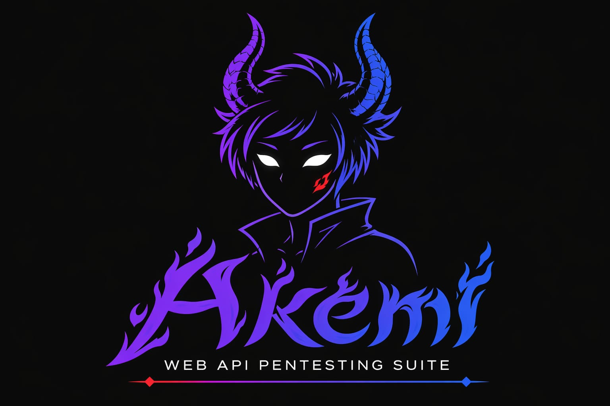
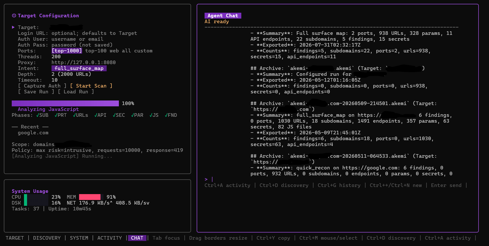
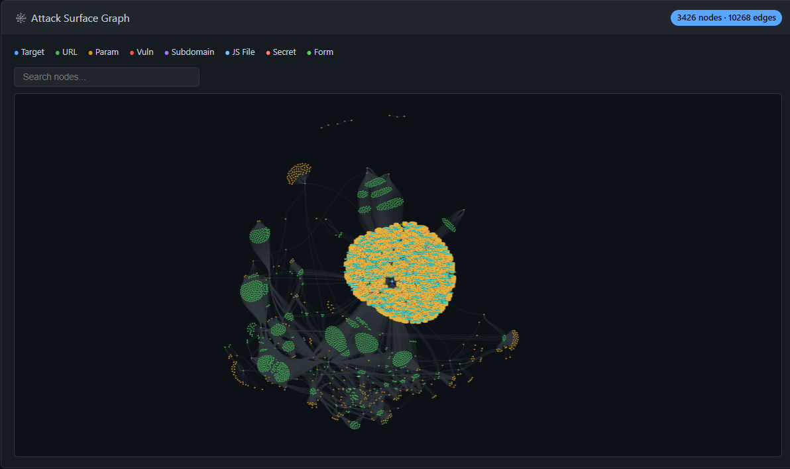

# Akemi: Autonomous Attack Surface Management

> **v2.1.0 development snapshot** - This release includes the v2 MCP server and autonomous agent tooling.
> For source, release notes, and downloads, visit [X-Wired/Akemi](https://github.com/X-Wired/Akemi).

**Akemi v2** is an AI-augmented, modular attack surface management framework that combines high-performance reconnaissance with LLM-driven autonomous agents. It can map, probe, and validate entire attack surfaces - either manually via CLI or autonomously through an AI agent that plans and executes engagements for you.

The framework integrates high-speed network triage (Akemi-Spear), deep web discovery, a YAML-driven vulnerability engine, and an LLM agent system into a single, cohesive environment with an optional rich terminal UI.

---

## 2.1 safety and result contract

The current 2.1 tree is a pre-stable development snapshot. Target-interacting
tools use a shared scoped run context: explicit root domains may authorize
their subdomains, while unrelated domains and discovered IPs remain outside
scope. Active and intrusive work can run autonomously inside that scope;
destructive actions require explicit approval.

Tool responses retain legacy fields and include an _akemi status metadata object.
Cookies, credentials, CSRF tokens, and other secrets are masked in MCP output,
assistant context, reports, and archives by default.


## Key Highlights

### LLM Agent System (NEW in v2)
Akemi v2 introduces an autonomous AI agent that can plan and execute entire engagements:
- **Multi-Vendor LLM Support**: Anthropic (Claude), OpenAI (GPT-4o), DeepSeek, Google (Gemini), and local models via Ollama/vLLM.
- **Autonomous Planning**: The agent analyzes targets, selects tools, and executes multi-step attack surface discovery - with human confirmation for destructive actions.
- **Safety Controls**: Configurable scope (domains, CIDRs), rate limiting, and risk levels (safe to intrusive).
- **Built-in Assistant**: Interactive chat interface for guided reconnaissance sessions.

### Terminal UI Dashboard (NEW in v2)
A rich, keyboard-driven TUI for real-time engagement monitoring:
- **Live Dashboards**: Track discovery, fuzzing, agent tasks, and findings in real time.
- **Notification System**: Inline alerts for high-severity findings and agent decisions.
- **Dark/Light Themes**: Customizable styling for your terminal.

### MCP Server & Client (NEW in v2)
- **MCP Server**: Expose Akemi as a tool source for Claude Desktop and other MCP-compatible LLM hosts via stdio or HTTP (Streamable HTTP).
- **MCP Client**: Consume external MCP tools from other servers, bridging them into Akemi's agent workflow.

### DotHound Integration (Experimental)

Browser-based authentication capture is not bundled with this release.

### Akemi-Spear: High-Performance Recon Engine
At the heart of Akemi lies **Akemi-Spear**, a Rust reconnaissance engine built for speed and stealth:
- **High-Speed Host Discovery**: Multi-threaded sweep and SYN scanning capabilities.
- **Service Fingerprinting**: Efficient banner collection and service-oriented triage.
- **Port Scanning**: Template-based and customizable scanning logic optimized for reliability.
- **Resume Support**: Interrupted scans can be resumed from the last checkpoint.

### YAML-Driven Vulnerability Validation (Beta)
Akemi's **Probe Engine** is a beta feature. It uses a flexible, YAML-driven approach to validate vulnerabilities across your attack surface:
- **Customizable Templates**: The `probes/` directory contains active checks for SQLi, RCE, SSRF, deserialization, and more.
- **Protocol Agnostic**: Validate findings across HTTP, DNS, and TCP using structured logic.
- **Tag-Based Filtering**: Run only the templates relevant to your engagement (e.g., `--vuln-check-tags sqli,lfi`).

---

## Core Capabilities

### Reconnaissance
- **Attack Surface Mapping**: Automated web crawling, subdomain enumeration, and endpoint extraction.
- **Dynamic Parameter Mining**: Deep discovery of parameters from URLs, forms, JSON, and JavaScript files.
- **JavaScript Analysis**: Scrutinizes JS files for endpoints, secrets, and sensitive logic.
- **Port Scanning**: High-speed TCP and SYN scanning via Akemi-Spear.

### Vulnerability Validation
- **YAML Probe Engine**: Structured, template-driven vulnerability checks (Nuclei-inspired).
- **Fuzzing**: Parameter-based fuzzing with customizable wordlists and concurrency.
- **ExploitDB Correlation**: Match identified services/versions against the ExploitDB dataset.

### AI & Automation
- **Autonomous Agent**: LLM-powered planner that chains tools to achieve engagement goals.
- **Interactive Assistant**: Conversational interface for guided recon sessions.
- **Tool Bridge**: MCP client/server for cross-tool interoperability with Claude Desktop and other hosts.

### Visualization & Reporting
- **Relational Graphing**: Export scan results as interactive HTML or DOT graphs.
- **Comprehensive Reports**: Generate detailed HTML and JSON reports for every engagement.
- **TUI Dashboard**: Real-time terminal-based monitoring of all running tasks.

### Persistence & Archiving
- **SQLite/Postgres Backend**: Store engagements, findings, and agent state.
- **Session Archiving**: Save and restore complete engagement sessions.
- **Resume Support**: Interrupted scans and tasks can pick up where they left off.

---

## Repository Layout

```text
cmd/
  Akemi/                   CLI entrypoint & commands
internal/
  app/                     Core framework orchestration
  agent/                   LLM agent: planner, executor, memory, safety
  llm/                     Multi-vendor LLM clients (Anthropic, OpenAI, DeepSeek, Google, local)
  assistant/               Interactive AI assistant
  mcp/                     MCP server: tools, resources, prompts, transports
  mcpclient/               MCP client: tool routing & aggregation
  recon/                   Crawl, scrape, JS analysis, subdomain enumeration
  vuln/                    YAML probe engine & vulnerability checks
  fuzzing/                 Parameter fuzzing engine
  reporting/               HTML/JSON report & graph generators
  reportfiles/             Report file management
  tui/                     Terminal UI dashboard
  config/                  TOML configuration management
  persist/                 Database persistence (SQLite/Postgres)
  session/                 Engagement session state
  engagement/              Engagement lifecycle management
  surface/                 Full attack surface aggregation
  dothound/                DotHound integration
  toolbridge/              External tool bridging
  archive/                 Session archiving
  service/                 Service layer (discovery, reporting, scanner, vuln, subdomain)
  core/                    Shared types, errors, interfaces
  platform/                Platform-specific utilities (proxy)
Akemi-Spear/               High-performance Rust recon engine (port scan, banner grab, host discovery)
DotHound/                  Rust-based credential capture tool (MITM proxy + LibreWolf)
config/                    Runtime and proxy configuration examples
probes/                    YAML vulnerability templates
.github/                   CI/CD workflows
```

---

## Quick Start

> **Akemi v2.1.0 is under active stabilization.** Build from source below, or check [GitHub releases](https://github.com/X-Wired/Akemi/releases) for packaged binaries.

### Configuration

Copy the example config and edit it with your settings:

```bash
cp akemi.conf.example akemi.conf
# Edit akemi.conf - add API keys for LLM providers you want to use
```

### Build Instructions

Use the provided PowerShell script to build optimized binaries for Windows and Linux:

```powershell
./build.ps1
```

**Requirements:**
- Go `1.25.12` (the CI version)
- Rust `1.88.0` (for Akemi-Spear and DotHound)
- Docker Desktop or Docker Engine for container builds (optional)
- libpcap/Npcap and the required privileges only for SYN scanning

### Linux Installation

For Linux users, a dedicated installer script is provided to handle dependencies and automated building:

```bash
chmod +x installer.sh
./installer.sh
```

The script will:
- Install system dependencies (`libpcap-dev`, `libssl-dev`, etc.)
- Verify/Install Go and Rust toolchains
- Compile the core engine, Akemi-Spear, and DotHound
- Optionally symlink binaries to `/usr/local/bin`

---

## Common Workflows

### 1. TUI
All (Mostly) Akemi Capabilities in one TUI:
```bash
./Akemi.exe  (Or just ./Akemi)
```

### 2. Full Surface Mapping (Manual)
Discover everything on a target, including parameters and JavaScript endpoints:
```bash
Akemi.exe -u https://target.com --crawl --depth 3 --params --js --scrape --graph --report-dir ./results
```

### 3. Infrastructure Triage & Port Scanning
Leverage Akemi-Spear for high-speed scanning:
```bash
Akemi.exe --targets targets.txt --port-scan -ports 80,443,8080 --rate 1000
```

### 4. Vulnerability Probing
Validate high-impact vulnerabilities with structured templates:
```bash
Akemi.exe -u https://target.com --vuln-check --vuln-check-tags sqli,lfi
```

### 5. Relational Graph Generation
Visualize the discovered surface and its connections:
```bash
Akemi.exe -u https://target.com --crawl --graph --report-dir ./results
```

---

## Installation and compilation reference

Create a local configuration before running provider-backed features. The configuration can contain LLM-provider credentials, so `akemi.conf` is intentionally ignored and must never be committed.

```bash
git clone https://github.com/X-Wired/Akemi.git
cd Akemi
cp akemi.conf.example akemi.conf
```

On Windows PowerShell:

```powershell
Copy-Item akemi.conf.example akemi.conf
```

Build the core CLI directly when you only need the Go application:

```bash
go test ./...
go build -buildvcs=false -trimpath -o bin/Akemi ./cmd/Akemi
./bin/Akemi --version
```

`build.ps1` builds the Go CLI and the Rust tools. Its Linux cross-build needs the matching Rust target and linker; building under Linux or WSL is usually simpler for Linux releases.

```powershell
./build.ps1
```

Build the Rust components directly with locked dependencies:

```bash
(cd Akemi-Spear && cargo test --locked && cargo build --release --locked)
(cd DotHound && cargo test --locked && cargo build --release --locked)
```

For a containerized build:

```bash
docker build --build-arg GO_VERSION=1.25.12 --build-arg RUST_VERSION=1.88.0 -t akemi:2.1 .
docker run --rm akemi:2.1 --version
```

Akemi keeps local project databases, archives, and run output under `workemi/`. This directory, `.akemi` archives, and SQLite databases are ignored so engagement data remains local.

## 2.1 operating model

Version 2.1 routes target-interacting work through a common execution boundary. It applies configured scope, risk ceilings, cancellation, request/concurrency/response limits, result normalization, and secret redaction. Root domains only include their subdomains when configured; unrelated domains and discovered IPs stay outside scope. Destructive actions require explicit approval and otherwise fail closed.

Use Akemi only for authorized web discovery, infrastructure triage, template-based validation, agent-assisted engagements, MCP integration, and project workflows. The examples above show the supported CLI entry points; use `Akemi.exe <command> --help` for command-specific flags.

## CI/CD checks

The GitHub Actions pipeline validates release assumptions, Go linting and race-enabled tests, Windows/Linux Go builds, locked Rust tests and builds, Docker image and HTTP-MCP smoke tests, and Go/Rust dependency audits. Before a pull request, run the checks supported by your platform:

```bash
go test ./...
go vet ./...
docker compose --profile server config
```
if you want to contribute to akemi, ci/cd are avaliable for your PR. just follow the .github/workflows.


## License

This tool is provided for educational purposes and authorized security assessments only. Do not use this tool for any illegal activities. You may fork, modify, and share it with the community. Redistribution or sale of this software is not authorized.

---

> **Akemi v2.1.0** - pre-stable release candidate with MCP server/client and autonomous agent support. Visit [GitHub releases](https://github.com/X-Wired/Akemi/releases) for downloads.


